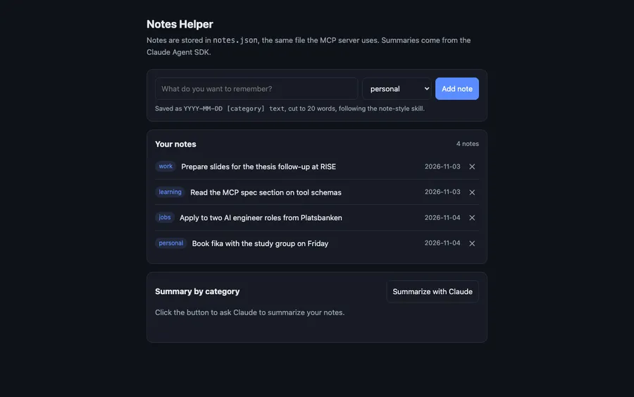

# Notes Helper

A small project that shows four ways to extend Claude Code (an MCP server, a skill,
the Agent SDK and a plugin), built around one idea: a personal notes list. A local web
page shows the same notes outside Claude Code.



*The local web UI with example notes.*

```
                 you type "add a note: buy milk"
                              │
                              ▼
   ┌───────────── Claude Code ─────────────┐
   │  skill: note-style                    │  <- tells Claude HOW to write a note
   │  "every note = date [category] text"  │
   └───────────────┬───────────────────────┘
                   │ calls tool add_note / list_notes
                   ▼
   ┌───────────── MCP server (server.py) ──┐  <- gives Claude the ABILITY to
   │  stores notes in notes.json           │     read and write notes
   └───────────────────────────────────────┘
                   ▲
                   │ same server, no human in the loop
   ┌───────────── summarize.py ────────────┐  <- Agent SDK: Claude Code as a
   │  "summarize all my notes by category" │     library you call from Python
   └───────────────────────────────────────┘

   notes-plugin/  <- all of the above packaged so anyone can install it in one step
```

## How it fits together

| Piece | File(s) | What it is |
|---|---|---|
| MCP server | `server.py`, `.mcp.json` | A Python program that exposes two tools, `add_note` and `list_notes`, over the Model Context Protocol. Without it Claude has no way to touch your notes. |
| Skill | `.claude/skills/note-style/SKILL.md` | A Markdown file of instructions. It makes Claude format every note as `YYYY-MM-DD [category] text`, under 20 words. |
| Agent SDK script | `summarize.py` | Uses the Claude Agent SDK to run Claude Code as a library: fixed prompt, same MCP server, prints a summary. No chat needed. |
| Plugin | `notes-plugin/`, `.claude-plugin/marketplace.json` | The server and the skill bundled together so someone else installs both with one command. |
| Web UI (extra) | `app.py`, `static/index.html` | A local web page (standard library only) to add, list, and delete notes, with a button that runs the Agent SDK summary. |

## Try it

```bash
python3 -m venv .venv
.venv/bin/pip install -r requirements.txt
claude                      # then: "add a note: buy milk", "show my notes"
.venv/bin/python summarize.py
.venv/bin/python app.py      # then open http://localhost:8787
```

## Install the plugin elsewhere

```bash
claude plugin marketplace add ParnaSaeidpour/Notes-Helper
claude plugin install notes-helper@notes-helper-marketplace
```

## License

[MIT](LICENSE)
